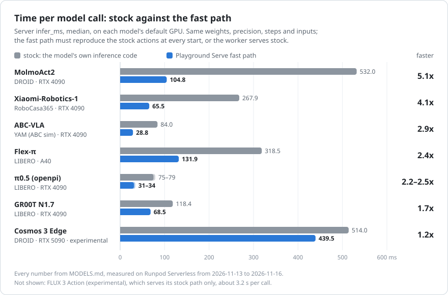
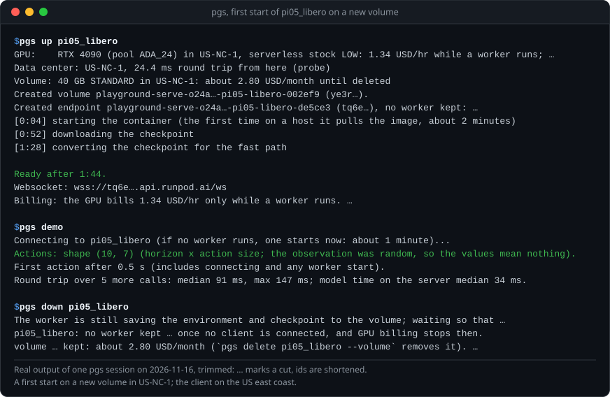
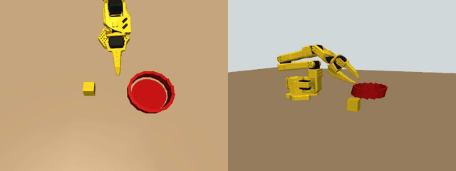

# Playground Serve

[](https://github.com/playground-systems/playground-serve/actions/workflows/tests.yml)
[](LICENSE)
[](pyproject.toml)
[](#status)

**Low-cost, open source inference for robot policies (VLAs). One command serves π0.5, MolmoAct2, GR00T and more from
a serverless GPU in your own cloud account.** `pgs up pi05_libero` starts the GPU, serves the vision-language-action
model over a websocket, and scales to zero when your robot stops calling it.

<p align="center">
  <a href="#quickstart">Quickstart</a> ·
  <a href="#models">Models</a> ·
  <a href="docs/BENCHMARKS.md">Benchmarks</a> ·
  <a href="#drive-a-robot">Drive a robot</a>
</p>

π0.5 on an RTX 4090, measured: ready about a minute after `pgs up` on a fresh account (median 65 s, 60 to 118 s over
nine first starts), 31 to 34 ms per model call against 75 to 79 ms for stock openpi, 61 ms round trip from the US
east coast to US-NC-1 (p50), 1.34 USD/hr only while a worker runs.

<p align="center">
  <picture>
    <source media="(prefers-color-scheme: dark)" srcset="docs/assets/model-time-dark.svg">
    <source media="(prefers-color-scheme: light)" srcset="docs/assets/model-time-light.svg">
    
  </picture>
</p>

- **One command, no image to build.** `pgs up MODEL` creates the endpoint and a network volume in your account, prints
  the price before it creates anything, and waits until the model serves. `pgs down` stops the GPU bill.
- **Eight model families, 23 entries:** openpi π0 and π0.5, MolmoAct2, GR00T N1.7, ABC-VLA, Xiaomi-Robotics-1,
  Flex-π, Cosmos 3 and FLUX 3 Action.
- **Faster, and still the same model.** Each fast path keeps the weights, precision, steps and inputs, and must
  reproduce the stock actions at every start or the worker serves stock: model calls 1.2x to 5.1x faster.
- **Your account, your choices:** the GPU, the region, a direct port past the gateway, your own checkpoints.
- **A small client:** four lines of Python 3.8+, openpi's websocket protocol, an action queue for control loops.

## Quickstart

You need a [Runpod](https://www.runpod.io) account with credit and Python 3.10 or later. The first `pgs up` asks for
a Runpod API key, says where to create it and which permissions to pick, and saves it for later commands.

```bash
pip install git+https://github.com/playground-systems/playground-serve
pgs up pi05_libero   # start the GPU server: about 1 to 2 minutes the first time
pgs demo             # send a dummy observation, print the actions' shape and the round trip
pgs down             # keep no worker: GPU billing stops within about a minute
```

<p align="center">
  
</p>

Real output of one session on 2026-11-16, trimmed: a first start on a new volume in US-NC-1 (the checkpoint download
and the fast path's conversion included), then `pgs demo` and `pgs down` from the US east coast.

On your robot or simulator:

```python
from playground_serve import connect, example_obs

policy = connect("pi05_libero")       # finds the endpoint that `pgs up` made
actions = policy.act(example_obs())   # pass your robot's observation here
print(actions.shape)                  # (10, 7): 10 steps of 7 action values
```

**What a first try costs:** a few minutes of RTX 4090 time at 1.34 USD/hr, about 0.10 to 0.20 USD (estimate), plus
the 40 GB volume that keeps the environment and checkpoint for faster restarts, about 2.80 USD/month until
`pgs delete pi05_libero --volume`. These are Runpod list prices read 2026-11-13; `pgs up` prints the live ones.

If this is useful to you, a star helps other robotics people find it.

## Status

Alpha (0.1.0). What is true today:

- 12 of the 23 model entries have served real actions on a Runpod GPU. The other 11 are registered and untested:
  `pi0_droid`, `pi0_fast_droid`, the five ALOHA entries, three more GR00T N1.7 suites and Cosmos 3 Nano. `pgs models`
  says which is which.
- Experimental (slow or not fully verified): Cosmos 3 Edge and Nano, and FLUX 3 Action (stock path only, 3.2 s per
  call).
- Fast paths serve only on the GPUs where they were measured ([MODELS.md](MODELS.md)); on any other GPU the model's
  stock path serves. Custom checkpoints have not run on a GPU.
- `pgs` was tested on macOS only. It installs from GitHub; it is not on PyPI yet.
- `pgs run so101` ([below](#drive-a-robot)) has driven a simulated arm, not yet a real one.

## Models

`pgs up NAME` takes any entry; `pgs models` lists the 23 robot models and the nine LLM agents with GPU or CPU, price, license and status.

| Family | Entries | Robot | Default GPU, USD/hr | Model time p50, stock → fast | Status |
|---|---|---|---|---|---|
| π0.5 (openpi) | `pi05_libero` | LIBERO (sim) | RTX 4090, 1.34 | 75–79 → 31–34 ms | ran on a GPU |
| π0.5 (openpi) | `pi05_droid` | DROID | RTX 4090, 1.34 | 86.6 ms, stock path | ran on a GPU |
| π0, π0-FAST, π0.5 (openpi) | `pi0_droid`, `pi0_fast_droid`, `pi05_aloha`, four `pi0_aloha_*` | DROID, ALOHA | RTX 4090, 1.34 | | untested |
| MolmoAct2 (Ai2) | `molmoact2_libero`, `_droid`, `_so101`, `_yam` | LIBERO, DROID, SO-101, bimanual YAM | RTX 4090, 1.34 | 521–575 → 104–139 ms | ran on a GPU |
| ABC-VLA (Amazon FAR) | `abc_vla_yam` | bimanual YAM | RTX 4090, 1.34 | 84.0 → 28.8 ms | ran on a GPU |
| Xiaomi-Robotics-1 | `xiaomi_r1_robocasa365` | RoboCasa365 (sim) | RTX 4090, 1.34 | 267.9 → 65.5 ms | ran on a GPU |
| GR00T N1.7 (NVIDIA) | `gr00t_n17_libero`; `_goal`, `_object`, `_10` untested | LIBERO | RTX 4090, 1.34 | 118.4 → 68.5 ms | ran on a GPU; needs `HF_TOKEN` |
| Flex-π | `flex_pi_libero` | LIBERO | A40, 1.22 | 318.5 → 131.9 ms | ran on a GPU |
| Cosmos 3 (NVIDIA) | `cosmos3_edge_droid`, `cosmos3_nano_droid` | DROID | RTX 5090, 1.89; Nano: A100, 2.99 | 514.0 → 439.5 ms (Edge) | experimental; Nano untested |
| FLUX 3 Action (Black Forest Labs) | `flux3_action_droid` | DROID | A40, 1.22 | 3180–3228 ms, stock path only | experimental; needs `HF_TOKEN` |
| LLM agents (through OpenRouter) | `fable_5_2`, `opus_5_5`, `gemini_4_carbon`, `gemini_4_argon`, `gemini_3_8_flash_high`, `gpt_6_astra`, `gpt_6_1_sol`, `muse_wonder_1_0`, `kimi_3_1` | any robot with an embodiment card | CPU (cpu3c, 2 vCPU), 0.072 | seconds to minutes per model call | answered a tool call with images; needs `OPENROUTER_API_KEY` ([MODELS.md](MODELS.md#llm-agents)) |

Model time is the server's `infer_ms` median on the default GPU. [MODELS.md](MODELS.md) has the p90s, other GPUs,
first-start times (up to 7:54 for Flex-π) and the conditions. Licenses differ: FLUX 3 Action is non-commercial,
MolmoAct2 is meant for research and educational use, and the openpi and ABC-VLA weights carry the Gemma Terms of Use;
`pgs models` prints each. Flex-π defaults to the A40: the RTX 5090 is 6.7 ms faster (125.2 ms) but had Serverless
stock only in Europe on 2026-11-16, which costs a robot in the US more round trip than that; `--gpu "RTX 5090"`
picks it.

## Why it is fast, and still the same model

Every family has two paths. **Stock** is the model's official inference code, called as its own server or evaluator
calls it (openpi's `Policy`, the MolmoAct2 repository's server, and so on). **Fast** is the same model with the same
weights and precision, the same number of denoising steps and the same inputs; what changes is how the work reaches
the GPU: CUDA graphs, compiled kernels, per-prompt work done once, image preprocessing on the GPU.

At every start a stored real frame must reproduce the stock path's stored actions within fixed bounds, twice. If it
does not, or the fast path fails to build, the worker serves stock and says why in its metadata (`path_reason`). For
π0.5 the fast path's actions differ from stock by 0.0014 on average at the same noise; a new noise draw moves them by
0.036.

An example: MolmoAct2 on an RTX 4090 spent about 440 of its 516 ms per call launching the small kernels of a 10-step
flow over 36 blocks. One CUDA graph around that loop, the model card's own setting that the repository's servers
leave off, gave 151 ms with bit-identical actions; compiling the blocks and preprocessing the images on the GPU brought
the served call to 104 ms. Each family's `NOTES.md` ([MolmoAct2's](src/playground_serve/families/molmoact2/NOTES.md),
for example) records what was measured, tried and left out.

## Why your own account

- **Your GPU.** `--gpu H100` serves on another Runpod Serverless GPU (RTX 4090, RTX 5090, A40, L40S, A100, H100,
  H200) at its price, which `pgs up` prints first.
- **Your region.** A new endpoint goes to the nearest data center with stock, by round trips measured from your
  machine (by its time zone until they are measured); `--region US-CA-2` picks one. Moving π0.5 from US-IL-1 to US-NC-1 took 24 ms off every request from the US
  east coast.
- **Your network path.** `--direct` sends requests straight to the worker's own address, with TLS and a per-boot token,
  instead of through Runpod's gateway: 13.2 ms less at p50 with `hot=True`, from the US east coast to US-CA-2
  ([trade-offs](docs/USAGE.md#direct-port)).
- **Your bill.** A worker bills only while it runs and stops 5 minutes after the last client leaves (`--idle`); the
  next connect starts one in about a minute. `--warm` keeps one running.
- **Your checkpoints.** `pgs up pi05_droid@gs://my-bucket/pi05_droid_finetune/30000` serves your fine-tune of any
  openpi config (untested on a GPU so far).
- **Your data.** Observations go from your machine to a worker in your account; the API key goes only to Runpod.

## Drive a robot

`pgs run so101` connects an SO-101 arm to `molmoact2_so101` through LeRobot's driver and plays the action chunks at
the model's 30 Hz, with limits on the robot side: the calibrated joint ranges, a speed cap, a hold when no action
arrives, a prompt before the first motion, and a return to the start pose on Ctrl-C. It starts no GPU.

```bash
pip install "playground-serve[so101] @ git+https://github.com/playground-systems/playground-serve"   # Python 3.12
pgs up molmoact2_so101
pgs run so101 --instruction "put the cube in the bowl" --dry-run   # reads the arm and cameras, moves nothing
pgs run so101 --instruction "put the cube in the bowl"             # asks, then moves for up to 60 s
```

<p align="center">
  
</p>

A simulated SO-101 (`pgs run so101 --sim`, MuJoCo) driven by `molmoact2_so101` on an RTX 4090: the two camera views
the model gets, 13 s of a 180 s run at about 3x speed. A plumbing check of the units, timing and limits, not a solved
task: the rendered scene is not what the model was trained on.

Status: it ran end to end against a simulated arm (`--sim`, MuJoCo) with the real model on an RTX 4090, 180 s at
29.7 Hz without an error. It has not run on a real SO-101 yet. Setup, units and safety: [docs/RUN.md](docs/RUN.md).

## Documentation

- [docs/USAGE.md](docs/USAGE.md): install options, the API key, every command and option, costs, how it works, limits.
- [MODELS.md](MODELS.md): every entry with its GPU, price, first start, model time, license and checks.
- [docs/BENCHMARKS.md](docs/BENCHMARKS.md): π0.5's start times, round trips and model time per GPU, with conditions.
- [docs/WIRE.md](docs/WIRE.md): the wire protocol, for a client in another language.
- [docs/RUN.md](docs/RUN.md): `pgs run`, the setup of an SO-101 arm, units and safety.

## Roadmap

- Run the 11 untested entries on a GPU, and bring the fast paths to more GPUs.
- `pgs run so101` on a real SO-101 arm.
- A local mode that serves on your own GPU, without Runpod.
- A PyPI release, so that `pip install playground-serve` works.

## Contributing

Issues and pull requests are welcome. [CONTRIBUTING.md](CONTRIBUTING.md) has the development setup with uv, the
tests and the release check that run on every pull request, and how to add a model family. A family is one folder,
`src/playground_serve/families/<family>/`, and changes no shared file; its fast path keeps the weights, precision,
steps and inputs, and must reproduce the stock actions at every start or the worker serves stock. Security problems go
through [SECURITY.md](SECURITY.md); the code of conduct is [CODE_OF_CONDUCT.md](CODE_OF_CONDUCT.md).

## License and credits

Apache License 2.0 ([LICENSE](LICENSE)). Playground Serve builds on [openpi](https://github.com/Physical-Intelligence/openpi)
by Physical Intelligence (Apache 2.0) and [realtime-vla](https://github.com/dexmal/realtime-vla) by Dexmal (MIT),
whose Triton kernels run π0.5's fast path. It serves models by Physical Intelligence, Ai2 (MolmoAct2), NVIDIA
(GR00T N1.7, Cosmos 3), Amazon FAR (ABC-VLA), Xiaomi (Xiaomi-Robotics-1), the Flex-π authors and Black Forest Labs
(FLUX 3 Action), each under its own license. [NOTICE](NOTICE) lists the third-party code and data; the openpi
checkpoints are subject to the Gemma Terms of Use.
